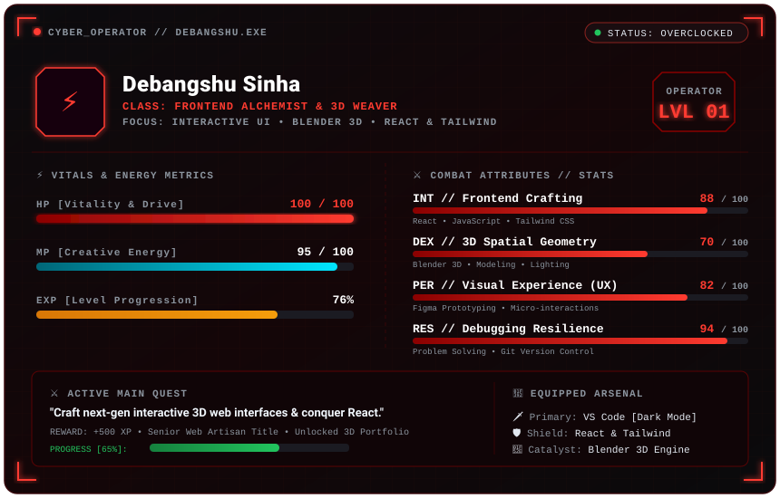

<!-- ================= HEADER ================= -->

 

 

<!-- ================= CHARACTER STAT SHEET ================= -->

<h2>⚔️ Operator Dossier // Debangshu.exe</h2>

  

<!-- ================= ABOUT ME ================= -->

<h2>🚀 About Me</h2>

  Hey there! I'm <b>Debangshu Sinha</b> — a passionate <b>Frontend Developer &amp; Creative Technologist</b> dedicated to crafting fast, responsive, and visually captivating digital products.

  💡 <b>What I Do:</b> I bridge the gap between engineering and design. From architecting scalable web applications with <b>TypeScript, React &amp; Tailwind CSS</b> to designing high-fidelity prototypes in <b>Figma</b> and experimenting with <b>Blender 3D</b>, I focus on building software that feels alive.

 

<table align="center">
  <tr>
    <td align="left">
      <b>🛠️ Project Highlights &amp; Experience:</b>  
      • 🚀 <b>Production-Ready Apps:</b> Built and deployed full-featured web solutions like <b>QR-RAKSHA</b>, <b>GhostTRACE</b>, and <b>Sahay</b>. 
      • 🎨 <b>Interactive Canvas &amp; UI:</b> Created dynamic interactive tools like <b>DraWILD</b> focusing on responsive design and fluid user experience. 
      • 🌐 <b>Real-World Problem Solving:</b> Developed civic &amp; safety platforms including hazard detection systems and crowd pass controllers. 
      • ⚡ <b>Clean Code Architecture:</b> Writing modular, maintainable, and type-safe code with modern frontend standards.
    </td>
  </tr>
</table>

 

  🎯 <i>"Clean code, pixel-perfect aesthetics, and seamless user experiences."</i>

 

<!-- ================= TECH STACK ================= -->

<h2>🛠️ Tech Stack</h2>

<h3>💻 Frontend</h3>

  

 

<h3>⚙️ Tools & Development</h3>

  

 

<h3>🎨 Design & 3D</h3>

  

 

<!-- ================= CURRENTLY LEARNING ================= -->

<h2>🌱 Currently Learning</h2>

 

<!-- ================= CODING MODE ================= -->

<h2>💻 Coding Mode</h2>

 

<!-- ================= SOCIALS ================= -->

<h2>📬 Connect With Me</h2>

  <i>📧 Always ready to work and feel free to contact.</i>

 

<!-- ================= GITHUB STATS ================= -->

<h2>📊 GitHub Statistics</h2>

  

  

  

 

<!-- ================= CONTRIBUTION GRAPH ================= -->

<h2>🐍 Contribution Activity</h2>

<picture>
  <source media="(prefers-color-scheme: dark)" srcset="https://raw.githubusercontent.com/debangshuuii/debangshuuii/output/github-contribution-grid-snake-dark.svg">
  <source media="(prefers-color-scheme: light)" srcset="https://raw.githubusercontent.com/debangshuuii/debangshuuii/output/github-contribution-grid-snake.svg">
  
</picture>

 

<!-- ================= FOOTER ================= -->

  <b>🔥 Keep Learning • Keep Building • Keep Creating 🔥</b>

  <i>Made with ❤️ by Debangshu Sinha</i>

